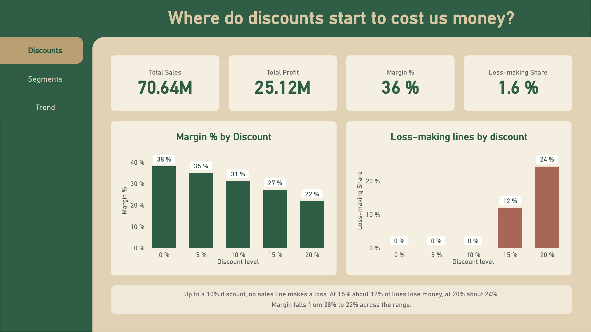
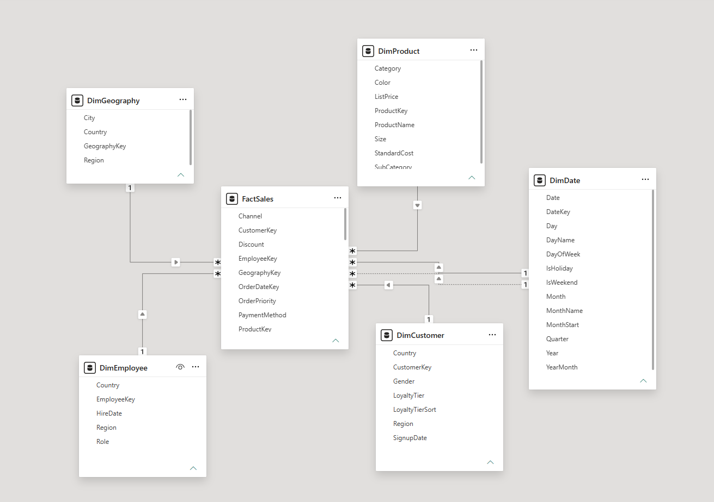
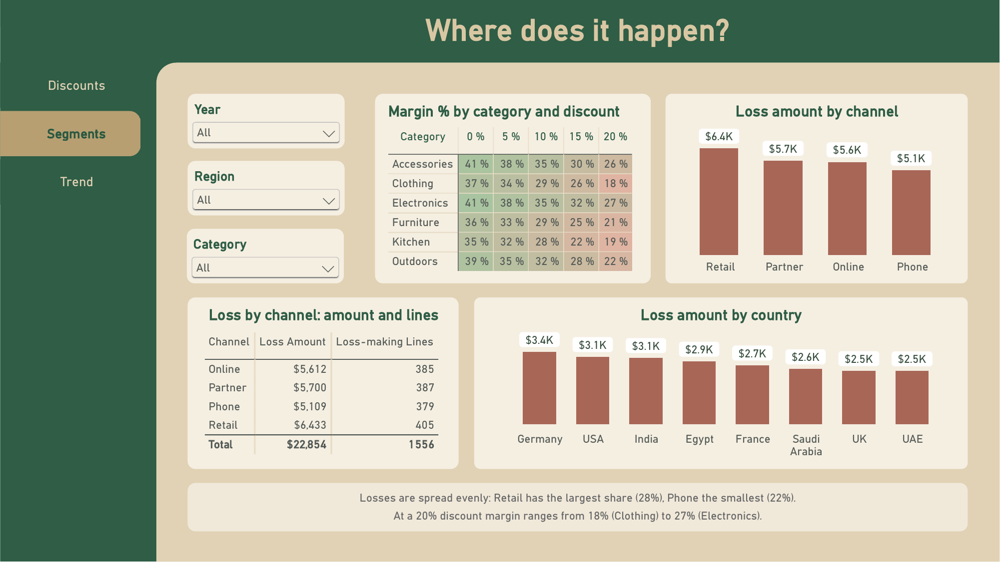
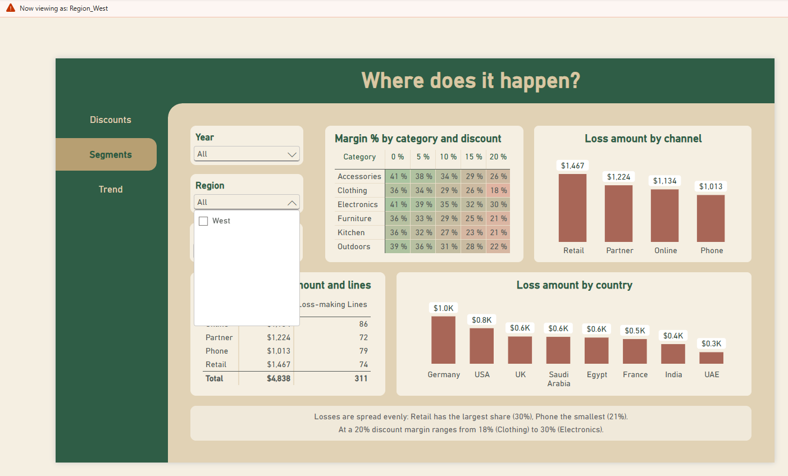

# Sales Performance Analytics

**Business question: where do discounts start to cost us money?**

A sales model in SQL Server and a three-page Power BI report built on it. The report answers the question, shows where the losses sit, and checks whether anything changes over time.



## What the data says

- Up to a 10% discount, no sales line makes a loss. Loss-making lines appear only at 15% (about 12% of lines) and 20% (about 24% of lines).
- Margin falls from 38% with no discount to 22% at a 20% discount.
- The losses are spread fairly evenly across channels: Retail has the largest share of the loss amount (28%), Phone the smallest (22%).
- No clear trend over time: yearly sales growth stays within 1.8% in 2019-2024, and the loss-making share holds between 1.4% and 1.7% every year.
- The effect is small in this dataset. 1.6% of the 100,000 sales lines lose money, and the total loss of $22,854 is under 0.1% of the $25.12M profit. The data is synthetic, so the project shows the method, not a real business result.

## Report pages

| Page | Question | Preview |
|---|---|---|
| Discounts | Where do discounts start to cost us money? | [docs/01-discounts.png](docs/01-discounts.png) |
| Segments | Where does it happen? (channel, category, country) | [docs/02-segments.png](docs/02-segments.png) |
| Trend | Is it changing over time? | [docs/03-trend.png](docs/03-trend.png) |

A PDF of all three pages: [docs/ZS_sales-performance.pdf](docs/ZS_sales-performance.pdf).

The text under the charts is not typed in: it is built by DAX measures and changes with the slicers and with the role.

## Data

Complete DAX Practice Dataset from Kaggle: a synthetic sales set of one fact table (100,000 sales lines) and five dimension tables.

- Source: https://www.kaggle.com/datasets/thesnak/complete-dax-practice-dataset
- License: Apache License 2.0, copy in [data/LICENSE.txt](data/LICENSE.txt)
- The six CSV files are stored in [data/](data/), so the project still runs if the Kaggle page changes or disappears.
- Details and the changes I made: [data/README.md](data/README.md)

## Model

CSV files go into SQL Server (database `ZS_SalesPerformance`), reporting views in schema `bi` form a star schema, and Power BI imports only those views.



- One fact table, `FactSales`, and five dimensions: date, product, customer, employee, geography.
- Every relationship is one-to-many from a dimension to the fact table, with the filter flowing one way.
- `FactSales` has two dates. The order date is the active relationship, the ship date is inactive and used only through `USERELATIONSHIP`.
- `DimDate` is marked as the date table, so time intelligence works.
- Customer and employee location is flattened into plain columns, so `DimGeography` relates only to the sales location and there is no second filter path.
- Customer and employee names, customer e-mail and phone are left out of the views, because the analysis does not need them.

## Key measures

| Measure | What it tells the business |
|---|---|
| Total Sales, Total Cost, Total Profit | Basic revenue, cost and profit |
| Margin % | Profit as a share of sales |
| Loss-making Lines | Number of sales lines with profit below zero |
| Loss-making Share | Share of lines that lose money, the main indicator for the discount question |
| Loss Amount | Total profit lost on loss-making lines |
| Sales LY, Sales YoY % | Sales in the same period last year and growth against it (`SAMEPERIODLASTYEAR`) |
| Sales by Ship Date, Ship vs Order Shift | Sales counted by ship date instead of order date (`USERELATIONSHIP`), and the difference per year |
| Insight Line 1/2, Seg Line 1/2, Trend Line 1/2 | Text conclusions under the charts, rebuilt for the current filters and role |

## Row-level security

Five static roles filter the geography table by region: `Region_Central`, `Region_East`, `Region_North`, `Region_South`, `Region_West`.

- Checked in Power BI Desktop with View as: totals under the five roles add up to the totals without a role, and the Region slicer lists only the region of the role.
- The text conclusions recalculate under a role (for example West: Retail has the largest share of loss, 30%).



The Region slicer under the same role offers only one value, West:



Limits to know:
- The role filters `DimGeography` only. Customer and employee tables have their own Region columns, which the roles do not use.
- RLS protects data in the Power BI service, not the `.pbix` file itself: whoever has the file has all the data.
- Publish to web does not support RLS.

## How to run

You need SQL Server Express (or any SQL Server) and Power BI Desktop on Windows.

1. The six CSV files are in the `data/` folder of this repository.
2. Open the scripts in `sql/` in SSMS or VS Code and run them in order:
   - `01_create_database.sql` creates the database `ZS_SalesPerformance`.
   - `02_create_tables.sql` creates the empty tables.
   - `03_load_data.sql` loads the CSV files. First replace `C:\data\sales\` with the full path to the `data` folder on your computer (the path appears in six lines). The script ends with a row-count check and a profit check (both are explained in the comments).
   - `04_views_star_schema.sql` creates the `bi` views.
3. Open `powerbi/ZS_sales-performance.pbix`. If the server name differs from `localhost\SQLEXPRESS`: Transform data - Data source settings - Change source. For a local Express instance, turn off "Use encrypted connection".
4. Refresh the data.

## Design

The look of the report is my own design: beige and green palette, DIN fonts, rounded panels, a page navigator on the left. The styling lives in a theme file, [powerbi/ZS_theme.json](powerbi/ZS_theme.json), and can be adapted to a company's brand identity by changing the colors and fonts in the theme and recoloring the page frame.

Not everything is in the theme: the side panel, the navigator and the page titles are built on each page. Fonts are referenced by name, not embedded in the `.pbix`, so a machine without DIN shows a fallback font. The PDF has the fonts embedded.

## Limits

- The data is synthetic. Findings show the method, not real business results.
- The amounts lost are small compared with profit, so the report answers "where do losses start", not "how much money is at risk".
- Orders cover 2018-2024. The calendar extends into 2025 so that ship dates fit, which is why the shipping-shift chart has a 2025 value, and why year charts show 2019-2024 (2018 has no previous year, and 2025 has no orders).
- The text "No clear trend" is written for this dataset; on other data the wording would need a rule.

## Repository

```
sql/        scripts 01-04: database, tables, load, star-schema views
powerbi/    ZS_sales-performance.pbix, ZS_theme.json
docs/       report PDF, page previews, model diagram, RLS check
data/       the six source CSV files, data notes, license copy
```

Tools: SQL Server Express, T-SQL, Power BI Desktop, DAX.
